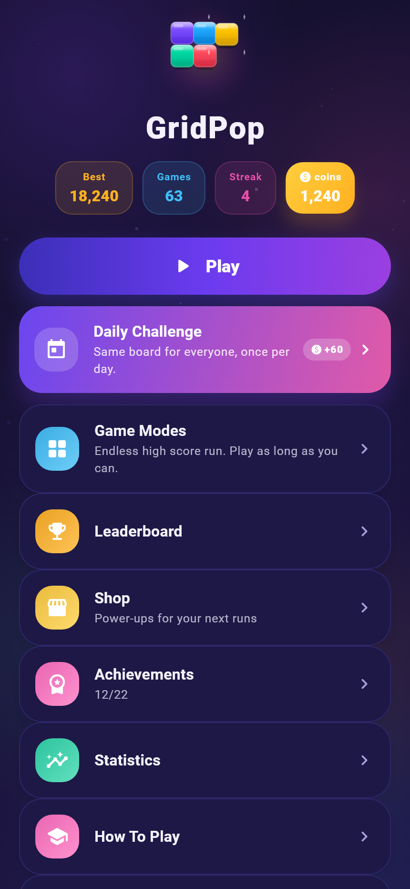
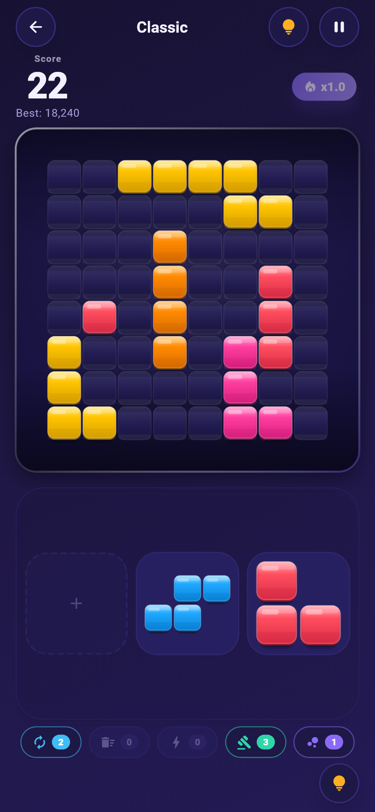
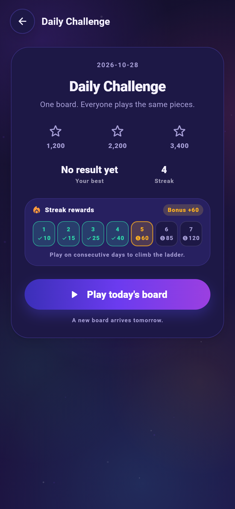
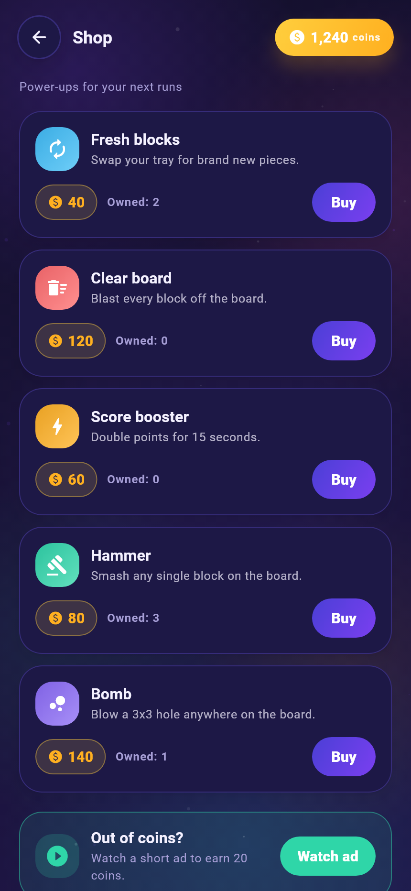
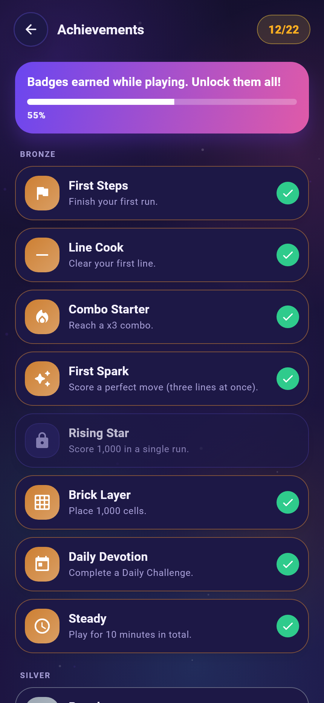
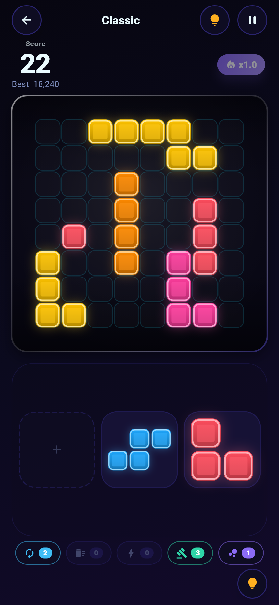
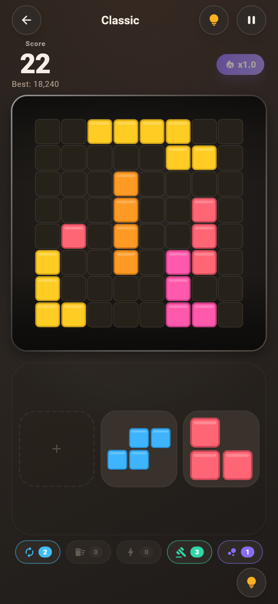
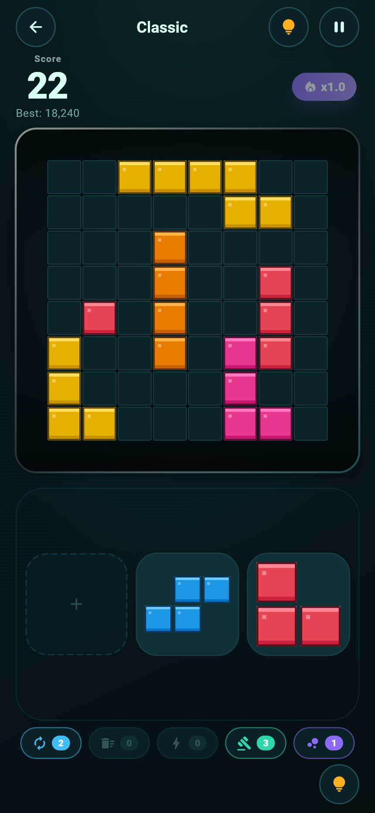
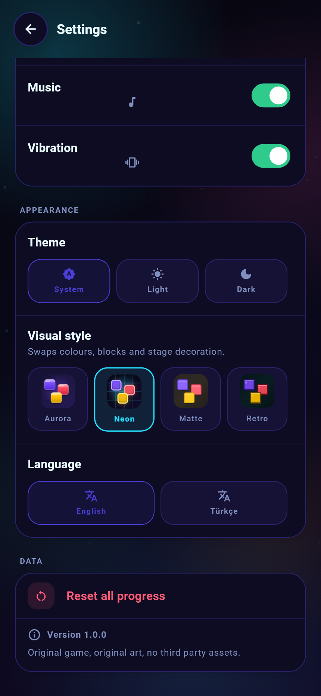

# GridPop

An original **block placement puzzle** for Android, iOS and Web, built with a single
Flutter code base. Drop colourful geometric pieces onto a square grid, clear rows and
columns, grow the combo multiplier and chase the high score.

> Everything in this repository — brand name, art, shapes, mechanics, sounds wiring,
> UI — is original to GridPop. It only borrows the *genre* ("place blocks, clear
> lines"), never any asset, name, code or visual identity of another game.

---

## Screenshots

<p align="center">
  
  
  
</p>
<p align="center">
  
  
</p>

The images are rendered by the real widget tree at phone resolution with the
bundled Roboto faces — no mockups. Regenerate them after a UI change:

```bash
# PowerShell
$env:SHOWCASE = "1"; flutter test test/showcase_test.dart --update-goldens
# bash
SHOWCASE=1 flutter test test/showcase_test.dart --update-goldens
```

`test/showcase_test.dart` is skipped in a normal `flutter test` run, so the
gallery never breaks CI.

---

## 1. Game identity

| | |
|---|---|
| **Name** | GridPop |
| **Tagline** | *Pop the grid. Chase the combo.* |
| **Genre** | Casual block placement puzzle |
| **Look** | "Aurora Pop": deep indigo stage, candy coloured soft-3D blocks |
| **Mark** | A 2x2 block cluster with one block popping out of the grid |
| **Platforms** | Android, iOS, Web (one codebase, zero platform specific code) |

### The shape library (26 original shapes)

`dot`, `dom`, `riser`, `bar`, `stalk`, `elbow`, `rail`, `tower`, `block`, `tee`,
`zigzag`, `zigzagFlip`, `hook`, `beam`, `spire`, `teeLong`, `corner`, `terrace`,
`plus`, `crown`, `bolt`, `fin`, `stairs`, `gate`, `arrow`, `monolith`, `tile`.

Every shape is defined once as `[row, col]` cells and pre-computes its rotations, so
symmetric shapes automatically report fewer distinct orientations (a line has 2, a 2x2
block has 1, a T has 4).

The block material is rendered procedurally (lip, vertical gradient face, top-left
gloss, bottom shade) so it stays crisp on every screen density and costs no assets.
A contact sheet is generated to `build/branding/piece-sheet.png`.

---

## 2. How to run

```bash
flutter pub get

flutter run -d chrome      # web
flutter run                # connected device / emulator

flutter build web          # web release
flutter build apk --release
flutter build ipa --release
```

Quality gates:

```bash
flutter analyze
flutter test
dart run tool/generate_brand_assets.dart   # regenerates icons + shape sheet
```

The tool prints the file list it wrote; it also refreshes `web/icons/*` and the
Android / iOS launcher icons with the original mark.

### Deploying the web build

The game is a static bundle: any web server works, and the repository ships a
ready nginx site plus one-command uploaders.

```bash
flutter build web --release --pwa-strategy=none --no-web-resources-cdn
```

```powershell
.\deploy\deploy.ps1 -Server ubuntu@<ip> -KeyPath $HOME\.ssh\gridpop.pem   # Windows
```

```bash
HOST=ubuntu@<ip> KEY=~/.ssh/gridpop.pem ./deploy/deploy.sh               # WSL/macOS/Linux
```

Full walkthrough (Ubuntu on AWS EC2, HTTPS, troubleshooting):
[`deploy/README.md`](deploy/README.md). `--no-web-resources-cdn` is required —
the bundled CSP only allows same-origin scripts.

---

## 3. Gameplay

### Modes

| Mode | Board | Rule |
|---|---|---|
| **Classic** | 8x8 or 9x9 | Endless high score run, ends when nothing fits |
| **Daily Challenge** | 8x8 | Seeded per local day, everyone gets the same pieces, 3 stars |
| **Time Attack** | 9x9 | 90 seconds, maximum score |
| **Zen** | 9x9 | No timer, no game over: a dead tray is refilled |

### Controls (one code path for touch and mouse)

- **Drag** a tray piece onto the board; a ghost preview snaps to the grid.
- **Tap** a piece to rotate it (cycles through the distinct orientations).
- Release on an invalid cell: the piece snaps back and the board shakes.

The whole play area is wrapped in a single `Listener` that hit-tests the tray slots
manually, so finger drags on mobile and mouse drags on web behave identically.

### The three pieces work as one batch

This is the rule that keeps runs losable:

1. The tray shows three pieces.
2. Playing one leaves its slot **empty** (dashed placeholder) - no instant
   replacement.
3. The next two pieces can still be used.
4. Only when all three have been played does the tray refill **as a whole batch**.

The input gate is closed while a piece settles (see `MotionConfig.settleWindow`),
and the batch is generated when the settle animation ends, so the player always
watches the result of a move before choosing again. A safety timer releases the
gate even if the animation layer stalls.

Death happens when, after a batch arrives, **none** of the three pieces can be
placed: the run ends with a warning pulse, a haptic nudge and a toast
("No space left for this piece!"). Relaxed modes (Zen, Time Attack) refresh the
tray instead.

### Scoring

| Event | Points |
|---|---|
| Placed cell | +1 |
| Cleared row | +20 |
| Cleared column | +20 |
| Each additional line in the same move | +30 |
| Three or more lines at once ("perfect") | +120 |
| Combo | line points are multiplied by `1 + 0.25 x combo`, capped at 6x |

A combo level is gained for every move that clears at least one line and lost as soon
as a move clears nothing.

#### Score surge (booster)

Passing the all time record mid-run starts a **10 second ×2 surge**: every point
scores double while the badge counts down in the HUD. Power-ups from the shop
start a 15 second surge of the same kind.

### Coins and the shop

Finishing the Daily Challenge pays coins (`20 + 10 per star + score / 200`),
first completion of the day only. Watching a short rewarded ad (currently a
clearly labelled simulation that a real ad SDK can replace) pays 20 coins.

#### Streak ladder

Consecutive daily runs pay more: the reward ladder is `10 · 15 · 25 · 40 · 60 ·
85 · 120` coins for cycle days 1–7 (355 for a full week) and wraps to day 1
again on day 8, so the habit never runs out of a target. The bonus is added on
top of the normal daily payout, once per day, and the Daily Challenge screen
draws the seven steps — mint for the days already cleared, amber for the step on
offer — with the current bonus on the label. The main menu shows the same `+N`
pill on the daily card, and the streak chip keeps counting a run that was played
yesterday but not yet today.

Coins buy consumable power-ups, spent from the power bar under the board:

| Power-up | Price | Effect |
|---|---|---|
| Fresh blocks | 40 | Replaces the tray with a playable batch |
| Clear board | 120 | Blasts every block off the board |
| Score booster | 60 | Starts a 15 second ×2 surge |
| Hammer | 80 | Tap any single block to smash it |
| Bomb | 140 | Tap a block to blow a 3×3 hole around it |

Hammer and bomb are **targeted**: picking one arms it, every block gets a white
rim, the strip under the board says what to do, and the tool is only spent when a
block is actually hit. Smashing never awards points or lines, so it can only
recover a stuck board, never inflate a score.

### Second chance

When the tray is dead the run does not end straight away: the player is offered
**one** second chance per run, paid with 150 coins or a rewarded ad. Accepting
wipes the three fullest rows, deals a guaranteed playable tray and hands the
board back.

The offer is raised *before* the run is persisted, so statistics, leaderboard
entries and coins are written exactly once whether the player revives, declines
or simply closes the sheet — there is no rollback path and no double count.

### Achievements

22 badges (bronze / silver / gold) across lifetime statistics and single run
feats: first run, combos, perfect moves, high scores, daily devotion, marathon
play time and more. Badges unlock live during a run with a golden toast, and
the gallery shows progress bars for the cumulative ones.

### Game feel (juice) rules applied

| Technique | Implementation |
|---|---|
| Input gate | `GameController.lockInput` / `completePlacement` around the settle window |
| Input buffering | A press during the gate is remembered for `MotionConfig.inputGrace` (180 ms) |
| Hit stop | 70 ms freeze on a perfect move (`HitStop`) |
| Squash & stretch | Board scales to 1.03 and settles with `easeOutBack` on every placement |
| Staggered pop | Placed cells land as a wave (26 ms per cell, row-major order) |
| Landing dust | Three soft motes puff out from under every placed cell |
| Magnetic snap | The lifted piece glides onto the cells it will fill |
| Explosion | Expanding shock band + double ring on every cleared line, debris from every cell |
| Ripple clear | Cleared cells pop outward from the middle of the line, with a slight spin |
| Clear shake | Board trembles on both axes (scaled by line count) whenever lines pop |
| Particles | Squares for a normal clear, 14 four-pointed sparks for a perfect one |
| Combo ring | Gold/magenta radial ring around the board from combo level 3 |
| Combo banner | Headline lives in the upper third and drifts up, so it never hides the cleared line |
| Warning pulse | Board outline pulses red (fatal) or amber (recoverable) when nothing fits |
| Aim rims | Every remaining block gets a white rim while the hammer/bomb is armed |
| Row wipe | Revive drops the three fullest rows as debris, then kicks the clear shake |
| Screen shake | Scaled to the event, skipped for invalid drops only when "reduce motion" is on |
| Reduced motion | `MediaQuery.disableAnimationsOf` disables shake, squash, logo and confetti |

### Difficulty curve

The generator widens the shape pool with the score: tier 1 shapes stay common, tier 2
shapes unlock around 2 400 points and the 6-9 cell shapes around 4 200. Endgame safety
nets keep big shapes rare when the board is nearly full, and shapes larger than the
number of free cells are never generated.

The **first** tray of a run is guaranteed to contain at least one placeable piece
(nobody starts dead), while batch refills stay random — that randomness is what
makes a Classic run able to end.

---

## 4. Architecture

```
lib/
  main.dart                     composition root (builds and injects the services)
  app.dart                      MaterialApp + theme/locale wiring

  core/
    constants/
      app_constants.dart        board, scoring, motion, timer, daily tuning
      piece_catalog.dart        the 27 shape blueprints (pure data)
      storage_keys.dart         persistence keys
      app_strings.dart          en/tr localization tables + delegate
    theme/
      app_colors.dart           brand colours + resolved AppPalette
      app_theme.dart            light/dark ThemeData, radii, spacing, shadows
      piece_palette.dart        the 8 block materials (base/light/dark/accent)
    utils/
      grid_geometry.dart        board metrics, hit testing, piece bounds
      responsive.dart           breakpoints, paddings, board sizing
      seeded_random.dart        deterministic xorshift128 RNG
      date_keys.dart            local day keys, daily seeds
      score_format.dart         number / clock / duration formatting

  game/
    models/                     Board, PieceShape, PieceSlot, GridPosition,
                                GridExtent, GridAnchor, PlacementHint,
                                PlacementOutcome, ScoreBreakdown, GameState,
                                GameMode, GamePhase, GameEvent, ScoreRecord
    logic/                      placement_engine, scoring_engine, combo_tracker,
                                piece_generator, board_analyzer  (pure Dart)
    services/                   game_controller (orchestrator), daily_service,
                                leaderboard_service, haptics_service
    widgets/
      game_board_view.dart      board + tray + unified pointer handling
      piece_tray.dart           tray slots
      game_hud.dart             score, combo, timer, top bar
      painting/                 block_painter, board_painter,
                                effects_painter, piece_preview_painter
      effects/effects_layer.dart  transient animation state

  screens/
    home/ game/ daily/ leaderboard/ settings/ stats/ how_to_play/

  audio/audio_manager.dart      GameSound events + pluggable AudioBackend
  storage/storage_manager.dart shared_preferences with in-memory fallback
  state/                        AppScope, SettingsController, StatsController
  widgets/                      buttons, dialogs, animations, background, logo
```

### Design rules

1. **Game logic never imports Flutter.** `game/logic` and `game/models` are pure Dart,
   which is why the rules are cheap to unit test and easy to reuse.
2. **The UI renders an immutable snapshot.** `GameController.state` is a
   `GameState` value; widgets read it and never mutate the board.
3. **Events, not callbacks.** The controller queues `GameEvent`s
   (placed / invalid / gameOver / trayReset / ...). The screen drains the queue and
   decides what to animate, which keeps sound, haptics and animation out of the rules.
4. **No state management package.** `ChangeNotifier` + `InheritedWidget` is enough.
   The only runtime dependency is `shared_preferences`.
5. **Repaint instead of rebuild.** Every painter takes a `Listenable` and the board
   painter listens to the controller; a move repaints the board without rebuilding the
   widget tree. Ghost previews and the dragged piece live in `ValueNotifier`s.

### Performance notes

- The board is a flat `Uint8List` of `size * size` bytes (`0` = empty).
- Blocks are drawn without blur filters (fake 3D lip + gradient), so an 81 cell board
  stays cheap on web.
- The effects layer only ticks while something is animating.
- Dragging a piece repaints one layer, not the screen.
- On desktop/tablet the tray moves next to the board, and the HUD switches to a
  compact single-line layout, so landscape phones never overflow.

### Responsive layout

| Viewport | Layout |
|---|---|
| Phone portrait | HUD on top, board centred, tray underneath |
| Phone landscape | Compact HUD, board + tray side by side |
| Tablet | Same as desktop with larger paddings and a wider content column |
| Desktop / mobile web | Home menu uses a two column split above 1024 px |

---

## 5. Audio

V1 ships **without audio assets**, but the whole pipeline is ready:

```dart
enum GameSound { blockPickup, blockPlace, lineClear, combo,
                 buttonClick, gameOver, highScore, perfect }
```

`AudioManager` owns the sound/music flags, the one-shot requests and the looping music
handle. The actual output is delegated to an `AudioBackend`:

- shipped: `SystemSoundAudioBackend` (zero dependency, uses the platform system sounds)
- tests: `SilentAudioBackend`
- to add real sounds: implement `AudioBackend` (e.g. with `audioplayers`) and call
  `AudioManager.installBackend(...)`. No gameplay code changes.

Expected asset names: `block_pickup`, `block_place`, `line_clear`, `combo`,
`button_click`, `game_over`, `high_score`, `perfect_move`.

---

## 6. Persistence

`StorageManager` wraps `shared_preferences` and falls back to an in-memory map if the
platform channel is unavailable, so the game never crashes in a test or an exotic
embedder. Everything works fully offline — Classic mode never needs a network.

Stored values:

`highScore`, `totalScore`, `gamesPlayed`, `bestCombo`, `totalLinesCleared`,
`perfectMoves`, `totalCellsPlaced`, `totalPlaySeconds`, `soundEnabled`,
`musicEnabled`, `vibrationEnabled`, `themeMode`, `languageCode`, `boardSize`,
`showGhost`, `showHints`, `leaderboard`, `dailyRecord`, `coins`, `inventory`,
`achievements`.

### Untrusted storage

Local storage is user editable (on the web it is plain `localStorage`), so every
read is treated as hostile input:

- numbers are read through `jsonInt`/`safeRange` (`lib/core/utils/safe_numbers.dart`);
  strings, fractions and `Infinity` (JSON `1e999`) never reach `.round()`;
- counters and scores are clamped to non negative values, daily stars to `0..3`;
- day keys must be real calendar days (`DateKeys.isValidKey`), and `parseKey` is
  total, so an out of range date cannot crash the boot sequence;
- unknown achievement ids, leaderboard modes and shop items are dropped;
- language codes are whitelisted to `en`/`tr`;
- the leaderboard is re-sorted and capped at 25 entries on load.

Consequence: a player can still forge their own local coins or scores (there is
no server authority in V1). That is an accepted risk for an offline game — what
the hardening guarantees is that tampered data can never crash, deadlock or
corrupt a session.

`web/index.html` ships a strict CSP: no third party origin, no plugins, no
framing, no form posts; the build is fully offline.

---

## 7. Tests

```bash
flutter test
```

| File | Covers |
|---|---|
| `test/piece_shape_test.dart` | catalogue integrity, rotations, extents |
| `test/board_test.dart` | board storage, placement, line detection, copies |
| `test/placement_engine_test.dart` | valid/invalid moves, row, column, both at once, perfect moves, scoring maths |
| `test/board_analyzer_test.dart` | drop anchors, move detection, hint quality, generator fairness and difficulty |
| `test/game_controller_test.dart` | run lifecycle, moves, rotation, pause, game over, second chance, Zen refill, restart, records, daily, hints, coins, power-ups |
| `test/economy_test.dart` | wallet add/spend/persist, inventory add/consume/persist, shop catalogue |
| `test/achievements_test.dart` | catalogue integrity, engine thresholds, mode gating, controller persist/sync/reset |
| `test/persistence_test.dart` | storage round trips, settings, stats, leaderboard ranking, daily seeds, formatting, localisation |
| `test/audit_test.dart` | full function audit: date keys, storage, stats, daily streak/prune/ladder, leaderboard ranks, achievements, wallet, inventory, settings reset, pure logic, revive/smash tools, controller guards |
| `test/security_test.dart` | penetration tests: hostile primitives, forged economy/leaderboard/daily/achievements/settings, injection strings, oversized payloads, gameplay fuzzing, double finish |
| `test/widget_test.dart` | screens render on 360x640, 640x360, 768x1024, 1024x768, 1440x900, plus geometry, effects, shop, achievements, the power bar, the revive sheet and hammer aiming |
| `test/style_test.dart` | visual styles: storage round trips, tampered-value fallback, block material mapping, theme extension wiring, painter smoke test for all four styles, settings picker widget test |
| `test/showcase_test.dart` | README gallery generator; skipped unless `SHOWCASE=1`, then rewrites `docs/screenshots/*.png` (including the four style variants) |

---

## 8. Roadmap

**V1 — shipped**

Classic, score, high score, combo, animations, save system, Daily Challenge,
Time Attack, Zen, leaderboard, statistics, themes, four visual styles
(Aurora, Neon, Matte, Retro), EN/TR, achievements,
coin economy, shop with power-ups (fresh blocks, clear board, booster, hammer,
bomb), second chance revive, daily streak ladder, score surge.

**V2 — next**

More statistics (per mode heatmaps), shape
unlocks, difficulty settings, extra sound pack, rewarded ads SDK.

**V3**

Online leaderboard, user accounts, cloud save, daily missions, seasons, cosmetic
block skins.

**V4**

Ad SDK with rewarded ads, premium cosmetics, in-app purchases.

---

## 9. Design effects (implemented)

| Effect | Where |
|---|---|
| Piece pickup | Lift + scale animation, contact shadow, ghost preview and magnetic snap |
| Placement | Per-cell overshoot pop with stagger, dust puffs, board squash |
| Line clear | White flash, ripple pop with per-cell spin, sweep shine band, particles |
| Multi clear | Bigger sweep, extra particles, double shock ring, perfect screen flash |
| Combo | Elastic banner with the live multiplier and a rotating sunburst |
| Score popup | Rising `+N` text with a coloured glow |
| Hint | Triple pulse on the suggested cells plus the tray slot glow |
| Invalid drop | Red pulse on the target cells, board shake, haptic warning |
| New pieces | Tray slots pop in with `easeOutBack` |
| Coins | The coin pill pops whenever the balance changes |
| Logo | Four blocks drop in and the pop block springs out (`LogoMark(animate: true)`) |
| Game over | Board dims, dialog springs in with score, stars, summary and confetti on a record |
| Button press | Uniform scale on every interactive element, plus a 1.5% hover lift on web and desktop |
| Board entrance | The board slides up and fades in once per run (transform only, so drag maths stays exact) |
| Style swap | A short accent flash on the stage marks the new art direction |
| Reduced motion | `MediaQuery.disableAnimations` short circuits press, pop-in, count-up and the style flash; every animation still ends on its final pose |

---

## 10. Visual styles

GridPop ships four complete art directions. A style is not a colour filter: it
swaps the stage gradient, the board well, the socket shape, the block material
and the stage decoration in one go, and the choice is saved with the profile.

| Style | Stage | Blocks |
|---|---|---|
| **Aurora** (default) | Indigo aurora gradient, colour blooms, printed foil sparkle | Glossy toy cubes: bevel, bottom lip, specular highlight, cast shadow |
| **Neon** | Near-black cabinet, perspective grid floor, one accent bloom | Flat glowing tubes with a blurred bloom and a hot rim |
| **Matte** | Warm studio brown, paper grain, no blooms | Flat pastel faces, ink outline, a single contact shadow |
| **Retro** | Teal CRT with scanlines and a heavier vignette | Square pixels, chunky bevel, quantised shading, no blur |

<p align="center">
  
  
  
  
</p>
<p align="center">
  
</p>

The same mid-run position in all four styles, plus the picker that switches
between them (each swatch is painted by the real block painter, not an image).

### How it is wired

- `VisualStyle` (`lib/core/theme/visual_style.dart`) lists the four families.
  Each one owns a `VisualStyleSpec` with a dark and a light `StylePalette` plus
  the decoration flags `blooms`, `gridFloor` and `scanlines`.
- `AppTheme.light(style:)` / `AppTheme.dark(style:)` resolve that palette and
  register it on the theme as `GridPopTheme`, a `ThemeExtension`. A style switch
  is therefore a plain theme change: every widget that reads
  `AppPalette.of(context)` rebuilds, and the game state is never touched.
- The extension lerps discretely (nearest side wins) so theme animation can never
  blend two art directions into mud.
- `BlockStyle` is separate from `VisualStyle` so the logo can keep the soft
  material while the board uses another one. `BlockPainter` has one paint path
  per material, and the board, ghost preview, tray, how-to-play gallery, effects
  layer and settings swatches all pass the active style through.
- The picker lives in **Settings -> Appearance -> Visual style** and persists to
  `gridpop.visualStyle`; an unknown stored value falls back to Aurora.

---

## 11. License

GridPop is released under the [MIT License](LICENSE) — copyright (c) 2026
kaancetin3141. Use it, fork it, ship it, just keep the notice.

The bundled Roboto font is Apache-2.0; its licence ships in
[`assets/fonts/ROBOTO_LICENSE.txt`](assets/fonts/ROBOTO_LICENSE.txt).
